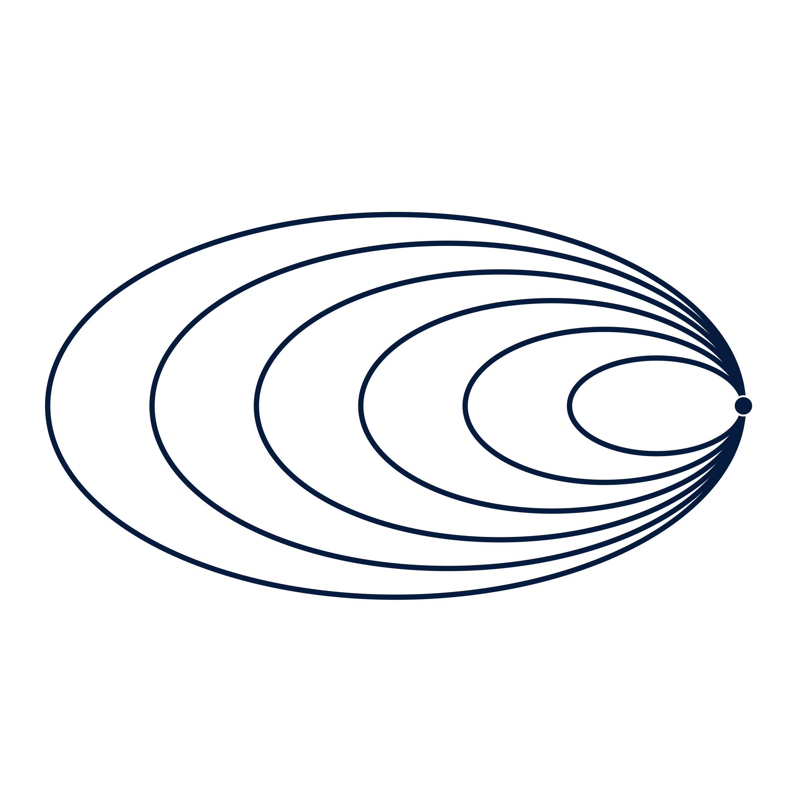
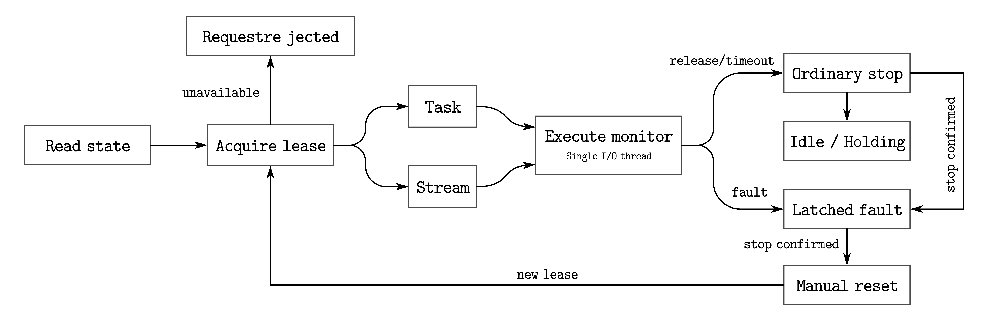

# Open-source infrastructure for spacecraft rendezvous and docking experiments.



[Website](https://rvdlab.strtus.uk) · [Documentation](docs) · [Issues](https://github.com/Strtus/rvd-railbench/issues)

RVDLAB connects research controllers to rail-based ground testbeds for spacecraft rendezvous and docking. It brings together a C++ experiment runtime, a Python hardware node, and a terminal interface for configuring the platform, running controllers, supervising motion, and recording experiments.

A physical experiment involves more than computing the next control input. Measurements arrive over a network, drives take time to respond, and several clients may need access to the same platform. RVDLAB gives these interactions explicit interfaces: physical units, timestamped feedback, exclusive control ownership, command deadlines, and defined stopping behavior.

The source is maintained in **RVD-RailBench** (`rvd-railbench`). The included PFCR controller provides a reference integration; the runtime and device interfaces are structured so that controller development and hardware adaptation can be carried out separately.

## What you can do

- **Develop without a rig.** Run local simulations with ideal, bounded-motion, or PLC-style plant models, configurable noise and delay, and fault injection.
- **Operate a shared testbed.** Use an authenticated hardware node to manage device access, stream controller targets, and execute waypoint tasks.
- **Run experiments from the terminal.** Configure rail geometry and coordinate mapping, position the platform, launch rendezvous runs, and inspect telemetry in RVDLAB.
- **Keep an inspectable experiment record.** Save resolved settings, controller inputs, trajectories, events, model hashes, and build metadata; verify recorded controller behavior offline.
- **Adapt the integration to your laboratory.** Describe axes, units, register maps, limits, and parking behavior in a hardware profile, extending the driver where device semantics differ.

## Quick start

Use Python 3.10 or newer in a virtual environment. Install the combined package, check the installation, and open the terminal interface:

```bash
python -m pip install "rvd-railbench[node]"
rvdlab --check
rvdlab
```

`rvdlab --check` runs a short local simulation without probing hardware. The package includes the C++ runtime binaries, the reference policy, default configurations, the terminal interface, and `rail-node`. The `node` extra supplies the cryptography dependency used for the node's TLS identity.

In the interface, configure a rail profile in **Rail Setup**, then choose a local simulation in **Autonomous Rendezvous**. A physical platform is optional for this workflow.

This README describes the `main` branch. Released packages can lag behind it; use a source checkout for changes that have not reached a release. Available installation and build options are documented in the [development guide](docs/development.md).

## System architecture

The research computer runs the controller and operator interface. A separate node, connected to the PLC, owns hardware I/O. This keeps device-specific communication and motion supervision close to the equipment while allowing experiments to run from another machine.


Figure 1. System architecture. The controller connects to a local Python bridge; the bridge communicates with rail-node over HTTPS, and rail-node accesses the PLC over Modbus TCP. Motion-capture data follows a separate VRPN path.

| Component | Responsibility |
| --- | --- |
| `pfcr_core` | Reference-controller mathematics and policy inference. |
| `rvd_runtime` / `rail_main` | Configuration, coordinate mapping, controller execution, runtime supervision, simulation, bridge I/O, and experiment records. |
| `tui/rvdlab` | Rail profiles, manual motion, rendezvous runs, telemetry, and experiment management. |
| Python bridge / `NodeClient` | Translate the runtime's `READ`, `SEND`, and `HOLD` operations into node requests. |
| `node/rvd_railnode` | Exclusive device ownership, feedback polling, motion tasks, Modbus access, optional VRPN reception, and stopping. |
| `rail_replay` | Integrity checks and offline verification of recorded controller inputs and outputs. |

Remote clients authenticate with a personal token and the node's CA certificate. One control thread owns hardware reads, writes, arming, and stopping; request handling, event logging, and motion-capture reception are handled separately.

The current controller bridge uses PLC encoder positions for feedback and controls the X/Y/Z translation axes. Hardware profiles can also describe pitch, yaw, and roll. Optional VRPN poses are available to the interface independently; they do not currently feed the PFCR control loop. See [hardware integration](docs/hardware-integration.md) for the exact interfaces and current limitations.

## Motion lifecycle

A control session begins with state checks and an exclusive lease. The lease identifies the client and the axes it may operate. The client maintains a heartbeat while the node checks feedback and commands locally.



Figure 2. Motion lifecycle. State checks and lease acquisition establish control; waypoint tasks or streamed setpoints drive motion; feedback and fault checks govern execution and stopping.

**Waypoint tasks** move through a sequence of targets. The node generates intermediate setpoints and confirms arrival using successive fresh feedback samples. This mode supports positioning and predefined moves.

**Streaming control** accepts continuously updated position and speed targets from a controller. Increasing sequence numbers, deadlines, travel limits, and target-horizon checks constrain what the node accepts.

An acknowledged command confirms completion of the node call; reaching a target requires feedback confirmation. Lease expiry, an expired stream deadline, or an operator stop revokes control. Feedback loss, stalls, drive dropouts, and interlock errors can latch a fault.

Stopping behavior accounts for the mechanics of the platform. Axes configured to hold a gravity-loaded structure remain enabled during ordinary stop and fault handling. **Park** moves enabled held axes to configured resting positions before releasing their drives. See [safety and stop behavior](docs/safety.md) before operating equipment.

## Build and run from source

The preset workflow requires a C++17 compiler, CMake 3.21 or newer, and Ninja. Python 3.10 or newer is required for the interface and node. On Windows, use an x64 Visual Studio developer shell or a configured MinGW toolchain.

```bash
git clone https://github.com/Strtus/rvd-railbench.git
cd rvd-railbench
cmake --preset release
cmake --build --preset release
ctest --preset release
python -m pip install -e "./node[test]" -e "./tui[test]"
rvdlab --root . --check
rvdlab --root .
```

The standalone C++ simulator and replay tool do not require Python at runtime. ONNX Runtime is optional; its build instructions are in the [development guide](docs/development.md#optional-onnx).

### Record a short simulation

From the repository root:

```bash
build/release/rail_main --config configs/rail.ini --config configs/pfcr_dqp.ini --config configs/simulation.ini --fast --max-steps 12 --experiment-dir experiments/example
```

This example uses a virtual clock and stops after at most 12 controller steps. Reaching that limit is reported as `LIMIT_REACHED` with exit code `1`; the resulting completed record can still be inspected and replayed. Use a new experiment directory for each run. On Windows, append `.exe` to the executable name.

```bash
build/release/rail_replay experiments/example
```

Configuration files are applied in order, and command-line arguments take precedence. Rail geometry and coordinate mapping, controller settings, and simulation settings are kept in separate files. See [configuration and experiments](docs/configuration.md).

## Experiment records and replay

An experiment directory preserves the inputs needed to inspect what happened and check the controller's recorded behavior.

| Record | Contents |
| --- | --- |
| `metadata.json`, `configuration.ini` | Resolved settings, model and artifact hashes, backend, build identity, seed, and clock information. |
| `trajectory.csv` | Measured positions, references, encoder data, and trajectory telemetry. |
| `initial_state.csv`, `controller.csv` | Full-precision initial state, controller inputs, expected outputs, and flags. |
| `events.jsonl`, `summary.json` | State transitions, faults, outcome, step count, and intervention counts. |
| `checksums.sha256` | Completion-time integrity manifest for the runtime records. |
| `rail_node.json` | Additional node-run context recorded by RVDLAB, including simulated axes and bridge speed floors. |

`rail_replay` verifies the record and feeds the saved inputs back through the controller without issuing hardware commands. It compares numerical outputs and status flags; exact replay requires the same backend and toolchain. It does not reconstruct the physical motion of the testbed.

For hardware experiments, archive the node profile with the laboratory record. The runtime snapshot does not contain that profile, and `rail_node.json` is outside the C++ checksum manifest. Bridge runs are marked `hardware: true` even when connected to a simulated node, so retain the actual node configuration and label mixed real/simulated-axis runs explicitly.

## Connect your laboratory

Start by exercising the node interface with its simulator. The following commands create a local node and start it in read-only mode:

```bash
rail-node init --directory rail-node-demo --address localhost --users researcher
rail-node serve --config rail-node-demo/node.json
```

In another terminal, inspect the node or connect RVDLAB:

```bash
rail-node status --config rail-node-demo/node.json --diagnostics
rvdlab --node rail-node-demo/access/researcher/connection.json
```

Without `--profile`, initialization creates simulated axes. Motion remains disabled until explicitly enabled in the node configuration or service arguments.

For a physical platform, provide a validated hardware profile describing axis directions, encoder scales and zero points, travel and speed limits, register addresses, readiness checks, and holding or parking behavior. Translation uses metres; rotation uses radians. Keep site-specific addresses, credentials, and TLS keys outside the repository, and give each user only their own access folder.

The supplied hardware backend targets Modbus TCP devices. Equipment with different command or stop semantics may require driver changes alongside configuration. Follow the [hardware integration guide](docs/hardware-integration.md) for read-only probing, node setup, commissioning, and remote access.

## Extend and contribute

Controllers implement `IController`. The included PFCR adapter operates on Hill-frame state, while the runtime handles the mapping into rail coordinates. New controllers should define their state, output, timing, and configuration requirements explicitly and include tests for their integration.

Contributions from other laboratories are particularly useful: device adapters, sanitized example profiles, reproducible fault reports, controller integrations, and documentation of commissioning procedures. Open an [issue](https://github.com/Strtus/rvd-railbench/issues) with the relevant software version, platform description, configuration, and a minimal reproduction. Remove credentials and private network details from shared records.

Run the node and interface test suites separately:

```bash
python -m pytest -c node/pyproject.toml node/tests -q
python -m pytest -c tui/pyproject.toml tui/tests -q
```

CTest covers numerical regression, runtime behavior, simulation, bridge integration, and replay. The Python suites use simulated devices and local test services. The [development guide](docs/development.md) documents the checks; the [baseline notes](docs/baseline.md) record the original numerical results and their limitations.

## Hardware safety

RVDLAB is research software for supervised ground experiments. Configure and verify units, travel, speeds, feedback timing, drive behavior, interlocks, and resting positions for the actual rig before enabling motion. Simulation tests provide software evidence; physical validation requires measurements on the deployed system.

Keep physical emergency stops, drive protections, and PLC watchdogs independent of the host process. Software holding depends on drive power. Review the [safety guide](docs/safety.md), including fault recovery and held-axis behavior, as part of commissioning.

## License

Licensed under the [Apache License 2.0](LICENSE).
